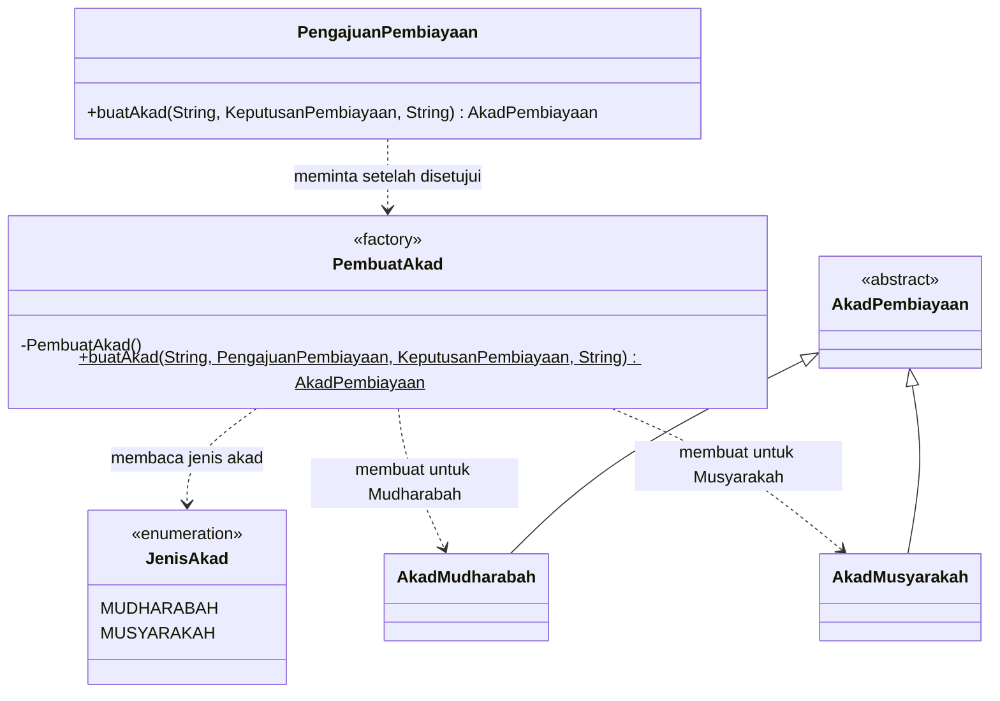
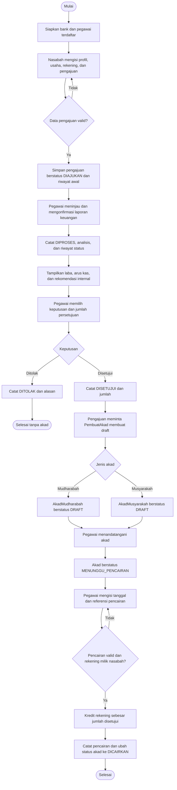

# UML dan Flowchart Pembiayaan Syariah

Diagram ini menggambarkan cakupan source saat ini: pengajuan pembiayaan
Mudharabah/Musyarakah, riwayat status pengajuan, persetujuan, akad, dan satu
kali pencairan penuh ke rekening nasabah. Proses berakhir setelah saldo
rekening bertambah. Aplikasi memiliki GUI JavaFX dan demo konsol; data GUI
berada di memori selama aplikasi berjalan. Rekomendasi analisis tidak mengambil
keputusan secara otomatis.

## Class diagram

```mermaid
classDiagram
direction LR

class Main {
  +main(String[] args) void
}

class BankSyariahApp {
  +start(Stage) void
  +main(String[] args) void
}

class BankSyariahController {
  -BankSyariah bank
  -PegawaiBank pegawai
  -List~CaseRecord~ records
}

class CaseRecord {
  <<private nested class>>
  -Nasabah nasabah
  -Usaha usaha
  -RekeningNasabah rekening
  -PengajuanPembiayaan pengajuan
  -KeputusanPembiayaan keputusan
}

class BankSyariah {
  -String kodeBank
  -String namaBank
  -List~PegawaiBank~ daftarPegawai
  +tambahPegawai(PegawaiBank) void
  +getKodeBank() String
  +getNamaBank() String
  +getDaftarPegawai() List~PegawaiBank~
  +memilikiPegawai(PegawaiBank) boolean
}

class PegawaiBank {
  -String nomorPegawai
  -String nama
  -String jabatan
  -BankSyariah bank
  +getNomorPegawai() String
  +getNama() String
  +getJabatan() String
  +getBank() BankSyariah
}

class Nasabah {
  -String nomorId
  -String nama
  -String alamat
  -String tanggalLahir
  -String pekerjaan
  -long gajiBulanan
  -List~Usaha~ daftarUsaha
  -List~PengajuanPembiayaan~ daftarPengajuan
  -List~RekeningNasabah~ daftarRekening
  +Nasabah(String, String, String, String, String, long)
  +tambahUsaha(Usaha) void
  +tambahRekening(RekeningNasabah) void
  +ajukanPembiayaan(PengajuanPembiayaan) void
  +getDaftarUsaha() List~Usaha~
  +getDaftarPengajuan() List~PengajuanPembiayaan~
  +getDaftarRekening() List~RekeningNasabah~
  +getIdPihak() String
  +getNamaPihak() String
  +getAlamatPihak() String
  +getTanggalLahirPihak() String
  +getPekerjaanPihak() String
  +getGajiBulanan() long
}

class Usaha {
  -String idUsaha
  -String namaUsaha
  -String sektor
  -String alamat
  -Nasabah pemilik
  +getIdUsaha() String
  +getNamaUsaha() String
  +getSektor() String
  +getAlamat() String
  +getPemilik() Nasabah
}

class RekeningNasabah {
  -String nomorRekening
  -Nasabah pemilik
  -long saldo
  +getNomorRekening() String
  +getPemilik() Nasabah
  +getSaldo() long
  ~kredit(long) void
}

class PengajuanPembiayaan {
  -String idPengajuan
  -Nasabah nasabah
  -Usaha usaha
  -long nominal
  -int tenorBulan
  -String tujuanPenggunaan
  -String tanggalPengajuan
  -JenisAkad jenisAkad
  -int nisbahBank
  -int nisbahNasabah
  -long modalNasabah
  -long omzetBulananDilaporkan
  -long biayaLangsungBulananDilaporkan
  -long biayaOperasionalBulananDilaporkan
  -long kewajibanUsahaBulananDilaporkan
  -StatusPengajuan status
  -RiwayatPengajuan riwayatPertama
  -RiwayatPengajuan riwayatTerakhir
  -AnalisisKelayakan analisisKelayakan
  -AkadPembiayaan akad
  -PegawaiBank pegawaiPenganalisis
  +PengajuanPembiayaan(String, Nasabah, Usaha, long, int, String, String, JenisAkad, int, int, long, long, long, long, long)
  +getIdPengajuan() String
  +getStatus() StatusPengajuan
  +getNasabah() Nasabah
  +getUsaha() Usaha
  +getNominal() long
  +getTenorBulan() int
  +getTujuanPenggunaan() String
  +getTanggalPengajuan() String
  +getJenisAkad() JenisAkad
  +getNisbahBank() int
  +getNisbahNasabah() int
  +getModalNasabah() long
  +getOmzetBulananDilaporkan() long
  +getBiayaLangsungBulananDilaporkan() long
  +getBiayaOperasionalBulananDilaporkan() long
  +getKewajibanUsahaBulananDilaporkan() long
  +getRiwayatPertama() RiwayatPengajuan
  +catatAnalisis(AnalisisKelayakan) void
  +getAnalisisKelayakan() AnalisisKelayakan
  +mulaiAnalisis(PegawaiBank, String) void
  +catatKeputusan(KeputusanPembiayaan) void
  +buatAkad(String, KeputusanPembiayaan, String) AkadPembiayaan
  -ubahStatus(StatusPengajuan, String, String, String) void
  +getAkad() AkadPembiayaan
}

class RiwayatPengajuan {
  -String waktu
  -StatusPengajuan statusSebelumnya
  -StatusPengajuan statusSesudahnya
  -String pelaku
  -String keterangan
  -RiwayatPengajuan berikutnya
  +getWaktu() String
  +getStatusSebelumnya() StatusPengajuan
  +getStatusSesudahnya() StatusPengajuan
  +getPelaku() String
  +getKeterangan() String
  +getBerikutnya() RiwayatPengajuan
  ~setBerikutnya(RiwayatPengajuan) void
}

class AnalisisKelayakan {
  -String idAnalisis
  -String tanggalAnalisis
  -PengajuanPembiayaan pengajuan
  -PegawaiBank pegawaiAnalisis
  -long omzetBulanan
  -long biayaLangsungBulanan
  -long biayaOperasionalBulanan
  -long kewajibanUsahaBulanan
  -String catatanRisiko
  +getIdAnalisis() String
  +getTanggalAnalisis() String
  +getPengajuan() PengajuanPembiayaan
  +getPegawaiAnalisis() PegawaiBank
  +getOmzetBulanan() long
  +getBiayaLangsungBulanan() long
  +getBiayaOperasionalBulanan() long
  +getKewajibanUsahaBulanan() long
  +hitungLabaOperasionalBulanan() long
  +hitungArusKasTersediaBulanan() long
  +hitungArusKasTersediaBulanan(long, long, long, long)$ long
  +getRekomendasiInternal() Rekomendasi
  +rekomendasiUntukArusKas(long)$ Rekomendasi
  +getCatatanRisiko() String
}

class "AnalisisKelayakan.Rekomendasi" as Rekomendasi {
  <<enumeration>>
  LAYAK_DIPERTIMBANGKAN
  PERLU_TINJAUAN
  TIDAK_DIREKOMENDASIKAN
}

class KeputusanPembiayaan {
  -String idKeputusan
  -String tanggalKeputusan
  -PengajuanPembiayaan pengajuan
  -PegawaiBank pegawaiPemutus
  -StatusKeputusan statusKeputusan
  -long jumlahDisetujui
  -String alasan
  +getIdKeputusan() String
  +getTanggalKeputusan() String
  +getPengajuan() PengajuanPembiayaan
  +getPegawaiPemutus() PegawaiBank
  +getStatusKeputusan() StatusKeputusan
  +getJumlahDisetujui() long
  +getAlasan() String
}

class PembuatAkad {
  <<factory>>
  +buatAkad(String, PengajuanPembiayaan, KeputusanPembiayaan, String)$ AkadPembiayaan
}

class AkadPembiayaan {
  <<abstract>>
  -String nomorAkad
  -BankSyariah bank
  -KeputusanPembiayaan keputusan
  -String tanggalJatuhTempo
  -long jumlahDisetujui
  -int nisbahBank
  -int nisbahNasabah
  -String tanggalTandaTangan
  -StatusAkad status
  -Pencairan pencairan
  +getNomorAkad() String
  +getJenisAkad() JenisAkad
  +getStatus() StatusAkad
  +getJumlahDisetujui() long
  +getPencairan() Pencairan
  +getBank() BankSyariah
  +getKeputusan() KeputusanPembiayaan
  +getTanggalJatuhTempo() String
  +getNisbahBank() int
  +getNisbahNasabah() int
  +getTanggalTandaTangan() String
  +tandatangani(String) void
  +cairkan(String, String, String, RekeningNasabah) Pencairan
}

class AkadMudharabah {
  +getJenisAkad() JenisAkad
}

class AkadMusyarakah {
  -long modalNasabah
  +getModalNasabah() long
  +getJenisAkad() JenisAkad
}

class Pencairan {
  -String idPencairan
  -AkadPembiayaan akad
  -RekeningNasabah rekeningTujuan
  -long jumlah
  -String tanggalPencairan
  -String referensiTransaksi
  +getJumlah() long
  +getIdPencairan() String
  +getAkad() AkadPembiayaan
  +getTanggalPencairan() String
  +getRekeningTujuan() RekeningNasabah
  +getReferensiTransaksi() String
}

class JenisAkad {
  <<enumeration>>
  MUDHARABAH
  MUSYARAKAH
}

class StatusPengajuan {
  <<enumeration>>
  DIAJUKAN
  DIPROSES
  DISETUJUI
  DITOLAK
}

class StatusKeputusan {
  <<enumeration>>
  DISETUJUI
  DITOLAK
}

class StatusAkad {
  <<enumeration>>
  DRAFT
  MENUNGGU_PENCAIRAN
  DICAIRKAN
}

Nasabah "1" o-- "0..*" Usaha : memiliki
Nasabah "1" o-- "0..*" RekeningNasabah : mendaftarkan
Nasabah "1" o-- "0..*" PengajuanPembiayaan : mengajukan
Usaha "1" <-- "0..*" PengajuanPembiayaan : usaha yang dibiayai
PengajuanPembiayaan "1" *-- "1..*" RiwayatPengajuan : riwayat status
RiwayatPengajuan "1" --> "0..1" RiwayatPengajuan : node berikutnya
PengajuanPembiayaan "1" <-- "0..1" AnalisisKelayakan : dianalisis
AnalisisKelayakan "0..*" --> "1" PegawaiBank : analis
KeputusanPembiayaan "0..1" --> "1" PengajuanPembiayaan : memutus
KeputusanPembiayaan "0..*" --> "1" PegawaiBank : pemutus
PengajuanPembiayaan "1" --> "0..1" AkadPembiayaan : memiliki akad
AkadPembiayaan <|-- AkadMudharabah
AkadPembiayaan <|-- AkadMusyarakah
BankSyariah "1" o-- "0..*" PegawaiBank : pegawai
AkadPembiayaan "0..*" --> "1" BankSyariah : diterbitkan bank
AkadPembiayaan "0..*" --> "1" KeputusanPembiayaan : berdasarkan keputusan
AkadPembiayaan "1" *-- "0..1" Pencairan : satu kali pencairan
Pencairan "0..*" --> "1" RekeningNasabah : rekening tujuan

BankSyariahApp ..> BankSyariahController : memuat controller FXML
BankSyariahController "1" *-- "0..*" CaseRecord : kasus selama aplikasi berjalan
CaseRecord "1" --> "1" Nasabah
CaseRecord "1" --> "1" Usaha
CaseRecord "1" --> "1" RekeningNasabah
CaseRecord "1" --> "1" PengajuanPembiayaan
CaseRecord "1" --> "0..1" KeputusanPembiayaan

PengajuanPembiayaan ..> PembuatAkad : meminta pembuatan setelah disetujui
PembuatAkad ..> AkadMudharabah : memilih untuk Mudharabah
PembuatAkad ..> AkadMusyarakah : memilih untuk Musyarakah
PembuatAkad ..> JenisAkad : memilih subtype
AkadPembiayaan ..> RekeningNasabah : mengkredit saat pencairan
AkadPembiayaan ..> Pencairan : membuat catatan pencairan
Main ..> PengajuanPembiayaan : menjalankan alur pengajuan
Main ..> AkadPembiayaan : menjalankan alur akad dan pencairan

PengajuanPembiayaan ..> JenisAkad
PengajuanPembiayaan ..> StatusPengajuan
AnalisisKelayakan ..> Rekomendasi : enum internal dan rekomendasi pegawai
RiwayatPengajuan ..> StatusPengajuan
KeputusanPembiayaan ..> StatusKeputusan
AkadPembiayaan ..> StatusAkad
```

Notasi: `*--` adalah komposisi, `o--` adalah agregasi, panah segitiga kosong
menunjukkan pewarisan, dan garis putus-putus menunjukkan ketergantungan.
Tanda `~` menunjukkan akses package-private. `getJenisAkad()` dideklarasikan
abstrak pada `AkadPembiayaan` dan diimplementasikan oleh kedua turunannya.
`KeputusanPembiayaan` direferensikan oleh `CaseRecord` pada controller GUI;
`PengajuanPembiayaan` menggunakannya untuk mencatat transisi status, tetapi
tidak menyimpan field keputusan. Rekening, data pegawai, dan catatan kasus pada
GUI tidak dipersistenkan setelah aplikasi ditutup.

## UML box factory untuk slide presentasi

Potongan ini dapat dipakai sebagai box `PembuatAkad` dan relasi langsungnya
pada slide class diagram:



Method factory bersifat static. `PengajuanPembiayaan.buatAkad(...)` tetap
menjadi pintu pemanggilan dari alur utama, sedangkan pemilihan subclass
didelegasikan ke `PembuatAkad`. Jika ada akad baru, daftar enum dan factory
perlu diperbarui bersama class akad baru; class pengajuan tidak perlu diberi
percabangan baru.

## Flowchart

Ringkasan ini menunjukkan alur GUI. Kesalahan validasi mengembalikan pengguna
ke formulir yang sedang dibuka; validasi yang gagal tidak mengubah status kasus.



Flow detail berikut dimulai setelah pengajuan berhasil dibuat dan dipilih pada
halaman pegawai.

```mermaid
flowchart TD
    A([Pegawai memilih Periksa data keuangan]) --> B[Form dibuka dengan laporan yang dimasukkan nasabah]
    B --> C[Pegawai mengoreksi nilai bila perlu, mengisi risiko, dan mengonfirmasi pemeriksaan]
    C --> D{Data dan konfirmasi valid?}
    D -- Tidak --> B
    D -- Ya --> F[pengajuan.mulaiAnalisis]
    F --> G[Status DIPROSES dan riwayat bertambah]
    G --> H[Buat AnalisisKelayakan dan hitung arus kas]
    H --> I[pengajuan.catatAnalisis]
    I --> J[Tampilkan rekomendasi internal kepada pegawai]
    J --> K[Pegawai membuka form keputusan]
    K --> L[Pilih status, jumlah disetujui bila setuju, dan alasan]
    L --> M{Data keputusan valid?}
    M -- Tidak --> K
    M -- Ya --> N[pengajuan.catatKeputusan dan simpan pada CaseRecord]
    N --> O{Keputusan pegawai}
    O -- Ditolak --> P[Status DITOLAK dan riwayat bertambah]
    P --> Q([Selesai tanpa akad])
    O -- Disetujui --> R[Status DISETUJUI dan riwayat bertambah]
    R --> S[Hitung jatuh tempo dari tanggal pengajuan dan tenor]
    S --> T{Jatuh tempo masih berlaku?}
    T -- Tidak --> T0([Kembali ke detail; akad belum dibuat])
    T -- Ya --> U[pengajuan.buatAkad memanggil PembuatAkad]
    U --> V{Jenis akad}
    V -- Mudharabah --> W[Buat AkadMudharabah berstatus DRAFT]
    V -- Musyarakah --> X[Buat AkadMusyarakah dengan modal nasabah]
    W --> Y[Pegawai memasukkan tanggal tanda tangan]
    X --> Y
    Y --> Z{Tanggal tanda tangan valid?}
    Z -- Tidak --> Y
    Z -- Ya --> AA[akad.tandatangani dan status MENUNGGU_PENCAIRAN]
    AA --> AB[Pegawai memasukkan tanggal dan referensi pencairan]
    AB --> AC{Tanggal tidak sebelum tanda tangan dan referensi terisi?}
    AC -- Tidak --> AB
    AC -- Ya --> AD[akad.cairkan memvalidasi akad dan rekening, lalu membuat Pencairan]
    AD --> AE{Validasi akad dan rekening lolos?}
    AE -- Tidak --> AE1[Pesan validasi; status dan saldo tidak berubah]
    AE1 --> AB
    AE -- Ya --> AF[Kredit saldo sebesar jumlah yang disetujui]
    AF --> AG[Simpan pencairan dan ubah status akad ke DICAIRKAN]
    AG --> AH[Tampilkan akad, pencairan, saldo, dan riwayat]
    AH --> AI([Selesai])
```



Nasabah mengisi omzet, biaya langsung, biaya operasional, dan kewajiban usaha
bulanan ketika mengajukan pembiayaan. Nilai tersebut disimpan pada
`PengajuanPembiayaan`, ditampilkan kembali sebagai nilai laporan, lalu disalin
ke formulir analisis agar pegawai dapat memeriksa atau menyesuaikannya. Tidak
ada angka contoh yang otomatis dipakai dalam GUI. Rekomendasi adalah alat
bantu internal berdasarkan angka yang telah diperiksa pegawai, bukan keputusan
otomatis dan bukan pesan persetujuan kepada nasabah. Rumus:
`laba operasional = omzet - biaya langsung - biaya operasional` dan
`arus kas tersedia = laba operasional - kewajiban usaha`. Hasil positif,
nol, dan negatif masing-masing menghasilkan rekomendasi
`LAYAK_DIPERTIMBANGKAN`, `PERLU_TINJAUAN`, dan `TIDAK_DIREKOMENDASIKAN`.
`Rekomendasi` adalah enum yang didefinisikan di dalam `AnalisisKelayakan`.
Nilai analisis hanya ditujukan untuk pegawai bank. Pegawai pemutus harus
terdaftar pada bank yang menangani analisis; pegawai merupakan bagian dari
bank dan direlasikan langsung pada diagram.

GUI memisahkan aksi pemeriksaan, penetapan keputusan, pembuatan draft akad,
penandatanganan, dan pencairan. Dengan demikian status `DIPROSES`, akad
`DRAFT`, dan akad `MENUNGGU_PENCAIRAN` tetap terlihat sebagai tahap tersendiri
sebelum pengguna melanjutkan. Membatalkan formulir kembali ke detail kasus
tanpa menjalankan operasi yang belum dikonfirmasi. Validasi gagal menampilkan
pesan dan mempertahankan formulir agar dapat diperbaiki. Tanggal jatuh tempo
diturunkan dari tanggal pengajuan ditambah tenor; jika tanggal itu sudah lewat,
draft akad tidak dibuat. Tanggal tanda tangan harus pada atau setelah tanggal
keputusan dan sebelum jatuh tempo; tanggal pencairan harus pada atau setelah
tanggal tanda tangan. Aplikasi GUI menggunakan satu bank dan pegawai contoh,
tidak memiliki autentikasi, dan menyimpan daftar kasus di memori.

Demo konsol pada `Main` berbeda dari GUI: ia menjalankan contoh Musyarakah
dengan nilai tetap dan keputusan disetujui yang ditentukan di source. Cabang
penolakan dan input formulir hanya tersedia pada GUI.

## Batas alur

- Satu akad hanya memiliki satu pencairan penuh.
- Pencairan menggunakan nominal keputusan yang disetujui; pengguna tidak
  mengisi nominal pencairan terpisah.
- Rekening nasabah dikredit saat pencairan berhasil.
- Setelah status akad `DICAIRKAN`, tidak ada proses lanjutan dalam cakupan
  program saat ini.
- Riwayat linked list hanya untuk perubahan status pengajuan.
